  

<h4 align="center">Building AI that runs on the device, not in the cloud.</h4>

<!--
  Every badge below is used by a project pinned on this page. TensorFlow,
  Dart, TypeScript and JavaScript were dropped for that reason. Add one back
  when a repo here uses it. ONNX Runtime and FastAPI came back with neutral,
  whose serving image runs on both.
-->

  
  
  
  
  

  
  
  
  
  

 

### Hi, I'm Ihsan

Computer Science undergraduate from Indonesia. I work on computer vision, NLP, and edge AI, mostly getting models to run on small hardware, so they keep working without a network.

I also shoot photos, work on audio, and build mobile apps, and a lot of my projects sit between those and ML. Currently exploring on-device LLM efficiency and multimodal edge AI. 

Open to internships and collaborations in Edge AI / MLOps, [ 📫 ](mailto:huftrash@gmail.com).

<!--
  Two details worth adding once you want them public, since a recruiter filters on both:
    1. University: "Computer Science undergraduate at <University>, Indonesia"
    2. Availability: "Open to internships ... available <month year> to <month year>"
-->

## Featured Projects

<table>
<tr>
<td width="50%" valign="top">

### [neutral](https://github.com/Ihsan-p1/neutral)

**Spots biased wording in news, one sentence at a time.**

DeBERTa-v3 scores 0.848 macro F1, up from 0.742 for a TF-IDF baseline. On a second dataset from other outlets it drops to 0.585, and the README puts that number right next to the good one. Serves through FastAPI on ONNX Runtime, with no PyTorch in the image.

</td>
<td width="50%" valign="top">

### [Sentra](https://github.com/Ihsan-p1/Sentra)

**Ask how different outlets framed the same story.**

A RAG chatbot over Indonesian English-language news, running on a 3B model through Ollama with no external API. Every answer is scored twice, by trained models and by plain rules, side by side, so you can see whether the model earns its place. When retrieval finds nothing close enough, it refuses instead of guessing.

</td>
</tr>
<tr>
<td width="50%" valign="top">

### [InfraSight](https://github.com/Ihsan-p1/InfraSight)

**One photo of a pothole, one volume estimate.**

YOLOv8-Seg outlines the hole, Depth Anything V2 reads how deep it goes, and a card or coin in the frame gives the scale. A Streamlit dashboard turns that into severity, repair cost, a map pin and a PDF report.

</td>
<td width="50%" valign="top">

### [TepiLog](https://github.com/Ihsan-p1/TepiLog)

**Photos organised by place, not by people.**

Every location keeps its own timeline, dated by when the photo was taken (EXIF) rather than when it was uploaded. Flutter app, Node and PostGIS backend, rotating refresh tokens with reuse detection, and CI on every push.

</td>
</tr>
<tr>
<td width="50%" valign="top">

### [MediSight-AI](https://github.com/Ihsan-p1/MediSight-AI)

**Reads emotion, drowsiness and pain from a webcam.**

The first numbers looked perfect: 99.97% on fatigue. They were wrong, because frames of the same person sat in both train and test. I withdrew them and re-measured on people the models had never seen. A plain eye-closure signal (EAR) then beat the drowsiness CNN, 0.760 vs 0.690 macro F1.

</td>
<td width="50%" valign="top">

### [Echo](https://github.com/Ihsan-p1/Echo)

**A robot that listens, looks, then answers.**

Whisper hears, YOLO11 sees, and Llama 3.2 3B replies, all on a laptop, while a Raspberry Pi 4 runs the camera, audio and motors. No LLM command reaches a motor without passing a three-layer safety gate, covered by 71 tests in CI. I tried a LoRA fine-tune and reverted it: the base model wrote more reliable structured output.

</td>
</tr>
</table>
